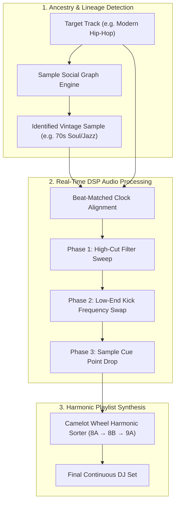

# CrateFlow — Cross-Platform Sample Lineage, DJ Transition & Harmonic Synthesizer

**CrateFlow** is a modern music discovery, sample lineage tracing, and algorithmic DJ platform. Built for crate-diggers, producers, and audio enthusiasts, CrateFlow identifies musical ancestry, executes mathematically beat-matched DJ transitions between contemporary tracks and their vintage vinyl origins, and synthesizes hybrid playlists by mining streaming social graphs.

Available as both a **Client-Side Web Application** (powered by the Web Audio API) and a **Native Android Application** (powered by Kotlin and Jetpack Compose).

---

## Repository Structure & Project Architecture

```
Web-Applications/CrateFlow-Audio-Engine/
├── web/              # Client-side Web Audio API DSP Studio
│  ├── src/            # React 19 + Tailwind CSS + Web Audio Engine
│  │  ├── api/          # Sample ancestry and playlist graph APIs
│  │  ├── audio/         # BiquadFilter, Crossfader & Beat-Clock nodes
│  │  └── components/      # Dual-deck HUD, spectrum analyzer, Camelot wheel
│  ├── package.json        # Vite + React build configuration
│  └── vite.config.js       # Bundler settings with base path support
│
├── android/            # Native Android Application (Jetpack Compose)
│  ├── app/src/main/java/     # Kotlin audio engine, MVVM architecture
│  │  ├── audio/         # DspCrossfader & AudioEngine implementations
│  │  ├── data/         # PlaylistSynthesizer & SampleRepository
│  │  ├── model/         # CamelotKey, Track, and SamplePair models
│  │  └── ui/          # DualDeckView, WaveformBar, AncestryTreeView
│  ├── build.gradle.kts      # Modern Kotlin DSL Gradle build
│  └── settings.gradle.kts    # Multi-module configuration
│
└── README.md           # Unified platform documentation
```

---

## Core Audio Engineering & Capabilities



### 1. Zero-Cloud-Cost Client-Side DSP Engine
- **Web Platform**: Runs 100% on the client device using the standard browser `AudioContext`. Employs `BiquadFilterNode` cascades for clean low-pass and high-pass sweeps without server compute bills.
- **Android Platform**: Native audio pipeline leveraging low-latency audio callbacks and custom DSP crossfading algorithms (`DspCrossfader.kt`).
- **4-Bar Automated DJ Transition Protocol**:
  - *Phase 1 (Sweep):* High-cut filter sweep progressively attenuates higher frequencies on the outgoing record.
  - *Phase 2 (Bass Swap):* Isolates and cleanly swaps sub-bass frequencies below 150 Hz to eliminate low-end phase cancellation and mud.
  - *Phase 3 (Drop):* Lands the incoming record on Beat 1 of the sample cue timestamp.

### 2. Multi-Playlist Social Graph Synthesizer
- **Consensus $\leftrightarrow$ Culture Bridge Continuum**:
  - *Consensus (Hive Mind):* Focuses on the most frequently co-occurring tracks across public Spotify, Apple Music, and YouTube Music playlists.
  - *Culture Bridge (Serendipity):* Discovers unexpected crossover tracks (e.g., connecting Chicago drill to 1970s Japanese fusion or French electro).
- **Harmonic Camelot Flow Sorting**: Automatically arranges tracks along the Camelot Wheel (8A $\to$ 8B $\to$ 9A) with smooth BPM step progressions for harmonic transitions.

---

## Quickstart & Running Instructions

### Running the Web Application
```bash
cd Web-Applications/CrateFlow-Audio-Engine/web
npm install
npm run dev
```
To create an optimized production build:
```bash
npm run build
```

### Building the Android Application
```bash
cd Web-Applications/CrateFlow-Audio-Engine/android
./gradlew assembleDebug
```
Open `Web-Applications/CrateFlow-Audio-Engine/android` in Android Studio (Ladybug or newer) and run on any emulator or physical device running Android 8.0+ (API Level 26+).
